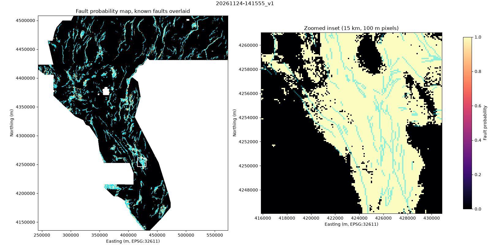

# V1: steel thread, per-pixel gradient-boosted trees

- **Branch / tag:** `main` at `cca3f0a`, to be tagged `v1`
- **Run folder:** `runs/20261124-141555_v1/` (runtime 37 s on the laptop CPU)
- **Config:** `configs/v1.toml`

## What we tried

The first end-to-end pipeline:
- per-pixel gradient-boosted trees on the 19 raw feature bands
- 5 spatial folds
- our own exact DTI scorer
- post-processing (threshold, power, scale) tuned by grid search on the local score
- a validated submission

There is no previous iteration.

## Why it should help

It is the baseline. It establishes how much signal the feature bands carry pixel by pixel, before any neighbourhood context (ADR 0003).

## Scores

| | Mean | Fold 1 | Fold 2 | Fold 3 | Fold 4 | Fold 5 |
|---|---|---|---|---|---|---|
| Local score, raw | 0.0698 | 0.0649 | 0.0658 | 0.0762 | 0.0734 | 0.0684 |
| Local score, post-processed | 0.1614 | 0.1479 | 0.1451 | 0.1735 | 0.1948 | 0.1455 |

- **Tuned post-processing parameters:** threshold 0.2, power 0.5, scale 3.0
- **Leaderboard score:** 0.0122 (submitted 2026-11-24)
- **Previous iteration, for comparison:** none

Post-processing more than doubles the local score (0.070 → 0.161), and every fold improves by a similar factor. Part of that gain is optimistic, because the same folds pick the parameters and score them (no nested cross-validation).

**The local vs. leaderboard gap is large:** 0.161 locally against 0.0122 on the leaderboard, about 13 times lower. Likely causes, roughly in order of suspicion:

1. **The local score rewards hugging known faults, and the leaderboard punishes it.** Locally, a predicted pixel within 300 m of a known fault carries a reduced false-positive weight and can earn true-positive credit. On the leaderboard, known-fault pixels are excluded and only new faults count. The same blobs around known faults then become almost pure false positives, unless new faults happen to lie nearby. The bold post-processing (8.3% of the area at 1) was tuned for exactly the local situation.
2. **New faults differ from known ones** (ADR 0001). They may be subtler, sparser or in different terrain, so the patterns the model learned from known faults transfer poorly.
3. **The baseline is weak.** A constant map of 1 over the whole study area scores 0.058 locally. The raw V1 score of 0.070 is barely above that, and the post-processed 0.161 is about 2.8 times it. We don't know what the constant map would score on the leaderboard.

The tuned post-processing is therefore probably far too aggressive for the leaderboard. We need a local score that imitates the official round better before trusting post-processing tuned on it.

## Preview maps

The submitted map is effectively binary:
- **8.3%** of the study area is predicted as exactly 1 and the rest as 0.
- That 1-region covers 63% of the known-fault pixels.
- The predictions form broad blobs over fault-rich terrain rather than lines. The inset shows a whole valley-and-range block lit up, with the known traces running through it.

## What we learned

- **The DTI rewards bold predictions.** With α = 0.2 and β = 0.8, a false negative costs four times as much as a false positive. The tuning therefore pushes everything above a low threshold to 1. Scale 3.0 with power 0.5 saturates the map.
- **The tuned power, 0.5, is at the bottom of its search range** (0.5, 1, 2), so the best value may lie lower. Threshold and scale are inside their ranges.
- **Per-pixel features find fault-prone terrain, not fault traces.** That matches ADR 0003: one pixel cannot see a line. The blobs are where V2's neighbourhood and lineament features should help.
- **The raw scores are consistent across folds** (0.065–0.076), so the spatial folds look reasonably balanced.
- **The scorer sanity check passes.** The provided sample submission scores DTI = 0 with known faults excluded, as in the official Initial Prize Round. Without the exclusion it scores ≈ 1.0, because it is a copy of the known-fault labels.

## Next ideas

- **Close the local/leaderboard gap first:** make the local score imitate the official round. One option is to split the known faults into "given" and "hidden" traces (for example by fault or by segment). We would train on and exclude the given ones, then score only the hidden ones, as the leaderboard does with new faults. Then retune post-processing against that score.
- **V2 as planned:** multi-scale neighbourhood and lineament features, aiming to turn blobs into traces.
- **Post-processing:** the local tuning wants a power below 0.5, but given the gap, don't push further in that direction until the local score imitates the leaderboard. A softer, less saturated map may do better on new faults.
- **Time budget:** a full run takes under a minute, so there is ample budget for heavier features and larger training samples.
