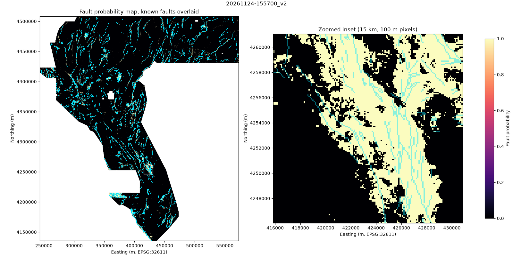

# V2: multi-scale neighbourhood and lineament features

- **Branch / tag:** `v2` branch, submission commit `183b253` tagged `v2`
- **Run folder:** `runs/20261124-155700_v2/` (runtime 388 s on the laptop CPU). The run's metadata records commit `47958e3` with a dirty tree. Those changes were then committed as `183b253`. Every source file was last modified before the run started, and the run's config parses identically to the committed one (only comments differ), so `183b253` is the code that produced the submission.
- **Config:** `configs/v2.toml`

## What we tried

V2 adds neighbourhood features to each of V1's 19 raw bands. The model, sampling, folds, withheld groups and post-processing grid are the same as in V1. The features are computed NaN-aware (normalized convolution), so gaps in the data don't spread:

| Feature | Scale | What it captures |
|---|---|---|
| Raw value | n/a | As in V1 |
| Anomaly (value minus focal mean) | 1 km, 3 km | Local highs and lows against their surroundings |
| Focal standard deviation | 1 km | Roughness |
| Gradient magnitude | 300 m | Steps and edges |
| Hessian ridge (signed dominant eigenvalue) | 1 km | Linear ridges (< 0) and troughs (> 0) |
| Structure-tensor coherence | 3 km | How strongly the local gradients share one direction (lineaments) |

That makes 7 features × 19 bands = 133 features, about 2.75 GB for the study area. Coherence at 300 m was dropped because it is about 1 everywhere. All 15 kind/scale pairs would take about 6 GB.

## Why it should help

A fault trace is a linear feature, and V1 saw each pixel alone (ADR 0003). Faults offset rock units, so they show up in neighbourhood terms:
- steps in magnetic and gravity fields (gradient)
- linear highs or lows (ridge)
- aligned gradients over kilometres (coherence)
- contrast with the surrounding block (anomaly)

The aim was to turn V1's blobs over fault-prone terrain into something closer to traces.

## Scores

Withheld-fault score (primary signal, ADR 0006):

| | Mean | Group 1 | Group 2 | Group 3 | Group 4 | Group 5 |
|---|---|---|---|---|---|---|
| Withheld-fault score, raw | 0.0177 | 0.0209 | 0.0137 | 0.0181 | 0.0188 | 0.0168 |
| Withheld-fault score, post-processed | 0.0321 | 0.0400 | 0.0192 | 0.0379 | 0.0374 | 0.0260 |
| Constant map of 1 | 0.0119 | 0.0131 | 0.0107 | 0.0112 | 0.0110 | 0.0133 |

Spatial-fold local score (kept for comparison with V1):

| | Mean | Fold 1 | Fold 2 | Fold 3 | Fold 4 | Fold 5 |
|---|---|---|---|---|---|---|
| Local score, raw | 0.0858 | 0.0772 | 0.0792 | 0.0889 | 0.0981 | 0.0855 |
| Local score, post-processed | 0.2005 | 0.1632 | 0.1781 | 0.2079 | 0.2439 | 0.2095 |

- **Tuned post-processing parameters:** threshold 0.25, power 0.5, scale 2.0. Because 2 × √0.25 = 1, the map is binary: every pixel with p ≥ 0.25 becomes 1.
- **Leaderboard score:** 0.0546 (submitted 2026-11-24)
- **Previous iteration, for comparison:** V1 scored 0.0205 on withheld faults (retuned) or 0.0160 (as submitted), and 0.0122 on the leaderboard.

| | V1 | V2 | V2 / V1 |
|---|---|---|---|
| Withheld-fault score, raw | 0.0129 | 0.0177 | 1.37 |
| Raw skill (ratio to constant map) | 1.09 | 1.49 | |
| Withheld-fault score, map as submitted | 0.0160 | 0.0321 | 2.0 |
| Leaderboard score | 0.0122 | 0.0546 | 4.5 |
| Leaderboard / withheld-fault score | 0.76 | 1.70 | |

- **Every withheld group improves**, raw and post-processed. Group 2 remains the hardest, and it gains the least (0.0160 → 0.0192 post-processed).
- **Post-processing still roughly doubles the score** (0.0177 → 0.0321). Part of that is optimistic: there is no nested cross-validation.
- **The leaderboard agrees on the direction, and the gap has flipped.** V1's withheld-fault score overstated its leaderboard score. V2's understates it by 1.7 times. Possible causes:
  1. **The neighbourhood features transfer better to new faults than to our withheld known faults.** New faults may be subtler, which is exactly where context beyond one pixel helps.
  2. **The public test set has a higher density of new faults than our withheld groups.** A constant map scores ≈ ρ / (ρ + 0.2), so every score rises with density.
  3. **Noise.** We have one leaderboard score per iteration on one public test set.

  The constant map's leaderboard score *s* (submitted 2026-11-24, due 2026-11-25) separates causes 1 and 2:

| *s* | V2 leaderboard skill (0.0546 / *s*) | Reading |
|---|---|---|
| ≈ 0.012 | ≈ 4.5 | The test density is like our withheld groups; V2 has more skill on new faults than the withheld-fault score measures (2.7). The score ranks maps correctly but is conservative. |
| ≈ 0.020 | ≈ 2.7 | The test set is denser (about 0.4%); the withheld-fault score's skill is calibrated, and its absolute value is low only because of density. |
| > 0.03 | < 1.8 | Density explains most of the jump; V2's real gain on new faults is smaller than it looks. |

## Preview maps

The submitted map is binary:
- **5.2%** of the study area is predicted as exactly 1, down from 8.3% in V1's submission. The withheld-fault tuning of V1 chose 25.5%.
- That 1-region covers 56% of the known-fault pixels (V1: 63%).
- 71% of V2's 1-pixels are also 1 in V1's submission.

The map is sharper than V1's but is still blobs, not traces. In the inset, the valley-and-range block is still mostly lit, now with holes and ragged edges along the margins. The gain comes mostly from flagging less of the wrong terrain, not from following individual traces.

## What we learned

- **Neighbourhood context carries real signal on unseen faults.** Raw skill rose from 1.09 to 1.49 times a constant map, and on the leaderboard V2 is 4.5 times V1.
- **A more skilful model gets a tighter map from tuning.** Under the withheld-fault score, V1's best map lit 25.5% of the area at p ≥ 0.1. V2's lights 5.2% at p ≥ 0.25. This matches the prediction in V1's record: let tuning decide.
- **The withheld-fault score ranked V1 and V2 correctly**, but its V2/V1 ratio (2.0) understates the leaderboard's (4.5). Until we know *s*, treat it as a ranking signal more than a calibrated estimate.
- **The features are still not trace-shaped.** The best features describe terrain at 1–3 km. The 300 m gradient is the only fine-scale feature, and at 100 m pixels a trace is 1–3 pixels wide.
- **Cost:** a full run takes about 6.5 minutes, up from 2, and memory sits near 3 GB for 133 features. Adding every kind/scale pair would double that.

## Next ideas

Checked against [the roadmap's known limitations](../roadmap.md#known-limitations--improvement-ideas):

- **Read the constant-map score first** and fill in the table above. If the withheld-fault score turns out to be conservative, consider larger cluster blocks or scoring only group-interior faults to bring it closer to the leaderboard.
- **V3 (U-Net) is the natural next step for traces.** The per-pixel model with hand-made filters still paints terrain. A convolutional model can learn line-shaped outputs directly. Use V2's 0.0321 withheld-fault score and 0.0546 leaderboard score as the bar.
- **Cheap V2 variants before V3:**
  - Check feature importance (permutation importance on one withheld group) to see which kinds and scales matter.
  - Add fine-scale ridge and coherence (300 m–1 km) for the top bands only, within the memory budget.
- **V4 (1 m DEM)** remains the largest untapped signal for scarps. It is still a data-engineering project, so weigh it against V3 given the Dec 3 deadline.
- **Post-processing:** the map is binary again. The grid is no longer at its edges (threshold 0.25, scale 2.0), so no change is needed. Nested cross-validation would show how optimistic the doubling is.
- **Ensembling (stretch):** V1 and V2 overlap by 71%, so averaging them adds little; save ensembling for V2 + V3.
